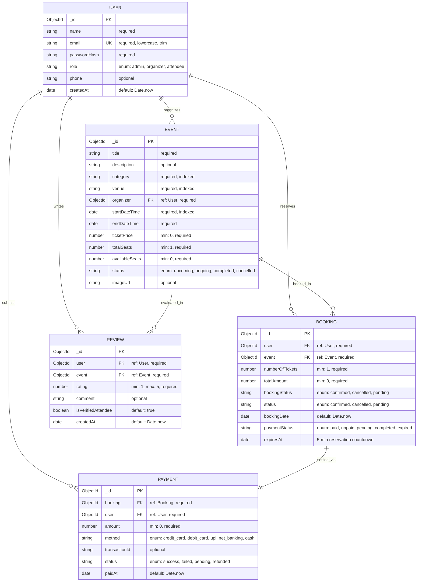

# EventHub — Full-Stack Campus Event & Ticket Management System

[](https://event-hub-dbms-project.vercel.app)
[](https://eventhub-backend-hkyw.onrender.com/api/health)
[](#academic-submission-details)
[-green.svg)](#tech-stack)
[](#database-schema--relational-normalization)
[](#1-acid-multi-document-transactions--concurrency-control)
[](#license)

---

## 🌐 Live Deployments

| Component | Platform | Live URL | Description |
| :--- | :--- | :--- | :--- |
| **Frontend Web Client** | **Vercel** | [https://event-hub-dbms-project.vercel.app](https://event-hub-dbms-project.vercel.app) | Responsive Single-Page Application (React 18 + Vite + Tailwind CSS) |
| **Backend REST API** | **Render** | [https://eventhub-backend-hkyw.onrender.com/api](https://eventhub-backend-hkyw.onrender.com/api) | High-performance Express.js REST API with Mongoose ODM |
| **API Health Check** | **Render** | [https://eventhub-backend-hkyw.onrender.com/api/health](https://eventhub-backend-hkyw.onrender.com/api/health) | Live JSON health check and platform uptime monitor |

---

## Academic Submission Details

| Field | Details |
| :--- | :--- |
| **Student Name** | **Pratham Tiwari** |
| **University UID** | **24BCS11185** |
| **Course** | **Database Management Systems (DBMS) — 5th Semester Lab Project** |
| **Academic Term** | 5th Semester |
| **Project Repository** | [EventHub — Campus Event Management](https://github.com/pratham-tiwari-09/eventhub) |

---

## 🔑 Evaluation & Demo Credentials

Use these pre-configured credentials to evaluate the platform or register a new attendee account:

| Role | Email Address | Password | Permissions & Testing Workflow |
| :--- | :--- | :--- | :--- |
| **Event Organizer** | `organizer@eventhub.com` | `organizer123` | **Organizer Access:** Create campus events, manage halls/venues, monitor seat inventory, view real-time reservation status. |
| **Self-Service Attendee** | *Register at `/register`* | *User-defined* | **Attendee Access:** Instant self-service registration. Reserve tickets, test the 5-minute seat countdown timer, simulate payments, cancel reservations, and post verified attendee reviews. |

---

## Table of Contents
- [Project Overview](#project-overview)
- [Core DBMS & System Features](#core-dbms--system-features)
  - [1. ACID Multi-Document Transactions & Concurrency Control](#1-acid-multi-document-transactions--concurrency-control)
  - [2. Time-Bounded Seat Reservation & Auto-Expiry Sweep Engine](#2-time-bounded-seat-reservation--auto-expiry-sweep-engine)
  - [3. Dynamic Time-Based Event Lifecycle & Booking Cutoff](#3-dynamic-time-based-event-lifecycle--booking-cutoff)
  - [4. Verified Attendee Review Integrity System](#4-verified-attendee-review-integrity-system)
  - [5. Indexing & Query Optimization](#5-indexing--query-optimization)
  - [6. Role-Based Access Control (RBAC)](#6-role-based-access-control-rbac)
- [Database Schema & Relational Normalization](#database-schema--relational-normalization)
  - [Entity-Relationship (ER) Diagram](#entity-relationship-er-diagram)
  - [Collection Schema Specifications](#collection-schema-specifications)
  - [Relational Normalization & Design Analysis](#relational-normalization--design-analysis)
- [Tech Stack](#tech-stack)
- [REST API Endpoints Summary](#rest-api-endpoints-summary)
- [Project Directory Structure](#project-directory-structure)
- [Local Setup & Installation Guide](#local-setup--installation-guide)
- [License](#license)

---

## Project Overview

**EventHub** is an enterprise-grade full-stack campus event discovery, ticket reservation, and administrative event management platform engineered specifically for university ecosystems. Designed to simulate real-world high-concurrency booking demands (such as campus festivals, hackathons, guest lectures, and cultural nights), EventHub demonstrates core Database Management Systems (DBMS) principles inside a modern Document-Relational architecture.

While built on MongoDB Atlas, the system rigorously enforces relational integrity, foreign key references, compound uniqueness constraints, and **ACID multi-document transactional guarantees** to eliminate race conditions, seat overbooking, and phantom reservations during simultaneous attendee checkouts.

---

## Core DBMS & System Features

### 1. ACID Multi-Document Transactions & Concurrency Control

In high-concurrency ticket reservations, multiple attendees simultaneously attempting to book the last available seat leads to race conditions, causing **dirty reads** and **overbooking**.

EventHub implements **ACID Multi-Document Transactions** using Mongoose Sessions and MongoDB Replica Sets with Snapshot Isolation:

- **File:** `server/controllers/bookingController.js`
- **Endpoints:** `POST /api/bookings` (`createBooking`) & `PATCH /api/bookings/:id/cancel` (`cancelBooking`)

```javascript
// Citation: server/controllers/bookingController.js
exports.createBooking = async (req, res, next) => {
  const session = await mongoose.startSession();
  session.startTransaction();
  try {
    const { eventId, numberOfTickets } = req.body;

    // 1. Read event within transactional snapshot
    const event = await Event.findById(eventId).session(session);
    if (!event) {
      await session.abortTransaction();
      return res.status(404).json({ message: 'Event not found' });
    }

    // 2. Lifecycle cutoff check
    if (isEventEnded(event)) {
      await session.abortTransaction();
      return res.status(400).json({ message: 'Cannot book tickets for an event that has already ended' });
    }

    // 3. Concurrency check: Ensure available seats satisfy requested tickets
    if (event.availableSeats < numberOfTickets) {
      await session.abortTransaction(); // Abort before state corruption
      return res.status(400).json({ message: 'Not enough seats available' });
    }

    // 4. Atomically decrement available seats in database
    event.availableSeats -= numberOfTickets;
    await event.save({ session });

    // 5. Create booking with 5-minute reservation countdown window
    const expiresAt = new Date(Date.now() + 5 * 60 * 1000);
    const booking = await Booking.create(
      [
        {
          user: req.user.id,
          event: eventId,
          numberOfTickets,
          totalAmount: numberOfTickets * event.ticketPrice,
          bookingStatus: 'confirmed',
          status: 'confirmed',
          paymentStatus: 'pending',
          expiresAt
        }
      ],
      { session }
    );

    // 6. Commit all operations simultaneously (Atomicity & Durability)
    await session.commitTransaction();
    res.status(201).json(booking[0]);
  } catch (err) {
    await session.abortTransaction();
    next(err);
  } finally {
    session.endSession();
  }
};
```

#### How ACID Guarantees Are Enforced:
- **Atomicity:** Both `event.availableSeats` reduction and `Booking.create()` occur together. If either crashes or validation fails, `session.abortTransaction()` reverts both operations.
- **Consistency:** The constraint `availableSeats >= numberOfTickets` is enforced before saving; the database never transitions into an invalid state where `availableSeats < 0`.
- **Isolation:** Snapshot isolation prevents other concurrent booking requests from reading uncommitted seat deductions.
- **Durability:** Upon `session.commitTransaction()`, changes are written to the MongoDB write-ahead journal and replicated across the Atlas replica set.

---

### 2. Time-Bounded Seat Reservation & Auto-Expiry Sweep Engine

When an attendee books tickets, seats are locked immediately with `paymentStatus: "pending"`. To prevent indefinite seat lockups when an attendee abandons checkout:

1. **5-Minute Reservation Window (`expiresAt`):**
   - Every pending booking sets `expiresAt = new Date(Date.now() + 5 * 60 * 1000)` upon creation.
   - When payment is successfully completed, `expiresAt` is cleared (`null`) and `paymentStatus` is marked `'paid'`.
2. **Dual-Trigger Atomic Sweep Engine (`releaseExpiredBookings`):**
   - **Periodic Daemon:** Runs every 30 seconds via `setInterval` in `server/index.js` to automatically clean up expired reservations.
   - **Pre-Fetch Trigger:** Executed immediately before querying events (`getAllEvents`, `getEventById`) and bookings (`getMyBookings`) so seat counts are always live and accurate.
3. **Zero Double-Refunding Race-Condition Protection:**
   - The sweep engine uses atomic `findOneAndUpdate` queries targeting `{ _id: b._id, paymentStatus: 'pending', bookingStatus: { $ne: 'cancelled' } }`.
   - If two concurrent threads sweep the same expired booking, only one transaction can acquire and update the document, guaranteeing that `Event.availableSeats` is **never refunded twice**.
4. **Live Frontend Countdown Timer:**
   - In `MyBookings.jsx`, pending bookings feature a live ticking badge (`Expires in MM:SS`).
   - When the countdown reaches `00:00`, the component triggers a background refresh; the booking state shifts to `CANCELLED / EXPIRED`, and the Pay button automatically disappears.

---

### 3. Dynamic Time-Based Event Lifecycle & Booking Cutoff

Event lifecycle transitions occur dynamically based on the current wall-clock time compared against `startDateTime` and `endDateTime`:

- **Upcoming:** Current time is before `startDateTime`.
- **Ongoing:** Current time is between `startDateTime` and `endDateTime`.
- **Completed:** Current time is past `endDateTime` (or past `startDateTime` if no end time was specified).
- **Cancelled:** Explicitly flagged as cancelled by an organizer or admin.

#### Booking Cutoff Enforcement:
- **Client Tier (`EventDetail.jsx` & `EventCard.jsx`):** Detects completed events, disables the ticket quantity selector, replaces the booking form with an informative `"Event Ended"` alert, and disables the checkout CTA.
- **Server Tier (`bookingController.js`):** Rejects any booking request for ended events with `400 Bad Request` (`"Cannot book tickets for an event that has already ended"`), preventing phantom ticket purchases via direct API calls.

---

### 4. Verified Attendee Review Integrity System

To guarantee review authenticity and prevent fraudulent ratings:

1. **Paid Booking Verification:**
   - `server/controllers/reviewController.js` queries the `Bookings` collection before allowing a review.
   - Requires `user === req.user.id`, `event === eventId`, `bookingStatus === 'confirmed'`, and `paymentStatus === 'paid'` (or `'completed'`).
   - Unverified users are rejected with `403 Forbidden` (`"Only verified attendees with a paid booking can review this event."`).
2. **Post-Event Timing Check:**
   - Attendees can only submit reviews after the event has started (`new Date() >= new Date(event.startDateTime)`).
   - Premature reviews are rejected with `400 Bad Request` (`"You can submit a review once the event has started."`).
3. **Compound Unique Uniqueness (`{ user: 1, event: 1 }`):**
   - Enforced by both application logic and a database-level unique index on the `Review` model, ensuring each attendee can submit **at most one review per event** (`400 Bad Request: "You have already reviewed this event"`).
4. **Frontend Verified Attendee Badge:**
   - The Event Details page conditionally displays the review form only for verified attendees.
   - Verified reviews display a prominent green `"Verified Attendee"` badge with a checkmark alongside the reviewer's name.

---

### 5. Indexing & Query Optimization

To transform linear collection scans (`COLLSCAN`) with time complexity $\mathcal{O}(N)$ into logarithmic index scans (`IXSCAN`) with time complexity $\mathcal{O}(\log N)$, custom B-Tree indexes are declared across schemas:

| Collection | Indexed Field(s) | Index Type | Purpose / Query Optimization |
| :--- | :--- | :--- | :--- |
| **User** | `{ email: 1 }` | **Unique Single-Field** | Enforces email uniqueness; provides $\mathcal{O}(1)$ lookup during login (`User.findOne({ email })`). |
| **Event** | `{ startDateTime: 1 }` | **Single-Field (Ascending)** | Accelerates chronological sorting, upcoming event filtering, and calendar views. |
| **Event** | `{ category: 1 }` | **Single-Field** | Optimizes category-based event discovery. |
| **Event** | `{ venue: 1 }` | **Single-Field** | Speeds up venue conflict checks and location-based searches. |
| **Booking** | `{ user: 1, event: 1 }` | **Compound Index** | Optimizes attendee booking lookups (`Booking.find({ user, event })`). |
| **Booking** | `{ paymentStatus: 1, expiresAt: 1 }` | **Compound Index** | **High-Frequency Sweep Index:** Powers the auto-expiry engine to find expired pending reservations instantly. |
| **Booking** | `{ expiresAt: 1 }` | **Single-Field** | Accelerates TTL and expiry queries. |
| **Payment** | `{ booking: 1 }` | **Single-Field** | Enables instant lookups of payment receipts linked to a booking ID. |
| **Payment** | `{ user: 1 }` | **Single-Field** | Accelerates attendee billing history retrieval (`/api/payments/mine`). |
| **Review** | `{ user: 1, event: 1 }` | **Compound Unique Index** | **Data Integrity Rule:** Enforces that an attendee can submit **at most one review per event**. |
| **Category**| `{ name: 1 }` | **Unique Single-Field** | Guarantees uniqueness for taxonomy classifications (`unique: true`). |

---

### 6. Role-Based Access Control (RBAC)

EventHub enforces the principle of least privilege using modular middleware pipelines:

```
Incoming Request
      │
      ▼
[ protect ] ─────────► Verifies JWT in Bearer Authorization Header
      │               Populates req.user = { id, role }
      ▼
[ role(['admin', 'organizer']) ] ───► Evaluates Role Authorization
      │                              Returns 403 Forbidden if unprivileged
      ▼
[ validator ] ───────► Express-validator input sanitization
      │               Returns 400 Bad Request on malformed payload
      ▼
Controller Action (ACID Transaction Session)
```

---

## Database Schema & Relational Normalization

### Entity-Relationship (ER) Diagram



---

### Collection Schema Specifications

#### 1. Bookings Collection (`server/models/Booking.js`)

| Field Name | Data Type | Constraints / Modifiers | Foreign Key Ref | Description |
| :--- | :--- | :--- | :--- | :--- |
| `_id` | `ObjectId` | Primary Key, Auto-generated | — | Unique reservation identifier |
| `user` | `ObjectId` | `required: true` | `User._id` | Attendee who placed reservation |
| `event` | `ObjectId` | `required: true` | `Event._id` | Target event being reserved |
| `numberOfTickets` | `Number` | `required: true`, `min: 1` | — | Count of tickets requested |
| `totalAmount` | `Number` | `required: true`, `min: 0` | — | Computed cost (`tickets * price`) |
| `bookingStatus` | `String` | `enum: ['confirmed','cancelled','pending']` | — | Lifecycle reservation status |
| `status` | `String` | `enum: ['confirmed','cancelled','pending']` | — | Synchronized with `bookingStatus` |
| `paymentStatus` | `String` | `enum: ['paid','unpaid','pending','completed','expired']` | — | Payment settlement flag |
| `expiresAt` | `Date` | Default: 5 min from creation for pending | — | Timestamp when unpaid hold expires |
| `bookingDate` | `Date` | `default: Date.now` | — | Timestamp when booking was created |

#### 2. Reviews Collection (`server/models/Review.js`)

| Field Name | Data Type | Constraints / Modifiers | Foreign Key Ref | Description |
| :--- | :--- | :--- | :--- | :--- |
| `_id` | `ObjectId` | Primary Key, Auto-generated | — | Unique review record ID |
| `user` | `ObjectId` | `required: true` | `User._id` | Review author |
| `event` | `ObjectId` | `required: true` | `Event._id` | Target event reviewed |
| `rating` | `Number` | `required: true`, `min: 1`, `max: 5` | — | 1 to 5 star rating score |
| `comment` | `String` | `required: false` | — | Textual attendee feedback |
| `isVerifiedAttendee` | `Boolean` | `default: true` | — | Attestation flag for verified attendees |
| `createdAt` | `Date` | `default: Date.now` | — | Timestamp review was published |

---

### Relational Normalization & Design Analysis

1. **First Normal Form (1NF):** Each collection contains atomic values (no repeating groups). Every document has an immutable Primary Key (`_id`).
2. **Second Normal Form (2NF):** Satisfies 1NF, and all non-key attributes are fully functionally dependent on the primary key `_id`.
3. **Third Normal Form (3NF):** Eliminates transitive dependencies. For example, `Booking` does not duplicate `Event.ticketPrice` or `User.name`; documents are joined dynamically at query time via Mongoose `.populate()`.
4. **Referencing vs. Embedding Trade-Off:** High-growth relational entities (`Bookings`, `Payments`, `Reviews`) use referencing to allow granular locks in multi-document transactions. Static entity attributes (`Venue.amenities`) use embedded arrays.

---

## Tech Stack

| Technology | Category | Role in System |
| :--- | :--- | :--- |
| **React 18** (`^18.3.1`) | Frontend Library | Component-driven UI rendering, state management, and real-time form bindings |
| **Vite** (`^5.4.14`) | Build Tool / Bundler | Rapid HMR dev server and optimized production asset bundler |
| **Tailwind CSS** (`^3.4.17`) | UI Styling Engine | Utility-first responsive design system |
| **React Router DOM** (`^6.28.2`) | Client Routing | Declarative client routing with protected route authorization wrappers |
| **Axios** (`^1.7.9`) | HTTP Client | Asynchronous communication with auth interceptors and dynamic base URL |
| **Lucide React** (`^0.475.0`) | Iconography | High-performance vector UI icons |
| **Node.js** | Backend Runtime | Non-blocking, event-driven JavaScript server runtime |
| **Express.js** (`^4.19.2`) | Backend Framework | REST API routing, middleware pipeline, and centralized error handling |
| **MongoDB Atlas** | Database | Cloud distributed document database cluster operating as a replica set |
| **Mongoose ODM** (`^8.4.0`) | Database Modeling | Schema enforcement, population, and multi-document session transactions |
| **JWT** (`^9.0.2`) | Authentication | Stateless authentication using cryptographically signed JSON Web Tokens |
| **Bcrypt** (`^5.1.0`) | Cryptography | One-way salted password hashing (10 salt rounds) |
| **Express-Validator** (`^7.0.1`) | Input Validation | Server-side request sanitization & validation |

---

## REST API Endpoints Summary

### Authentication Routes (`/api/auth`)
| Method | Endpoint | Access Level | Description |
| :--- | :--- | :--- | :--- |
| `POST` | `/api/auth/register` | Public | Registers a new user account with role selection |
| `POST` | `/api/auth/login` | Public | Authenticates credentials and returns signed JWT |
| `GET` | `/api/auth/me` | Protected | Retrieves profile data of currently authenticated user |

### Events Routes (`/api/events`)
| Method | Endpoint | Access Level | Description |
| :--- | :--- | :--- | :--- |
| `GET` | `/api/events` | Public | Retrieves all events with dynamic lifecycle status |
| `GET` | `/api/events/:id` | Public | Retrieves detailed event information by ID |
| `POST` | `/api/events` | Admin, Organizer | Creates and schedules a new event |
| `PUT` | `/api/events/:id` | Admin, Organizer | Updates event scheduling, venue, or pricing |
| `DELETE` | `/api/events/:id` | Admin, Organizer | Removes event and associated references |

### Bookings Routes (`/api/bookings`)
| Method | Endpoint | Access Level | Description |
| :--- | :--- | :--- | :--- |
| `GET` | `/api/bookings` | Admin | Retrieves all bookings across the university system |
| `GET` | `/api/bookings/mine` | Protected | Fetches booking history and live expiry countdowns |
| `GET` | `/api/bookings/:id` | Protected | Retrieves receipt for specific booking ID |
| `POST` | `/api/bookings` | Protected | **Atomic Seat Booking:** Executes ACID transaction session |
| `PATCH`| `/api/bookings/:id/cancel` | Protected | **Atomic Cancellation:** Restores seats to event inventory |

### Payments Routes (`/api/payments`)
| Method | Endpoint | Access Level | Description |
| :--- | :--- | :--- | :--- |
| `GET` | `/api/payments` | Admin | Audits system-wide transaction records |
| `GET` | `/api/payments/mine` | Protected | Retrieves payment history for authenticated user |
| `GET` | `/api/payments/:id` | Protected | Fetches specific transaction receipt |
| `POST` | `/api/payments` | Protected | Validates reservation window, records payment, clears `expiresAt` |

### Reviews Routes (`/api/reviews`)
| Method | Endpoint | Access Level | Description |
| :--- | :--- | :--- | :--- |
| `GET` | `/api/reviews/event/:eventId` | Public | Retrieves all ratings and verified attendee reviews |
| `GET` | `/api/reviews/eligibility/:eventId` | Protected | Checks whether user has paid booking and can review |
| `POST` | `/api/reviews` | Protected | **Verified Review Submission:** Enforces paid booking, timing & uniqueness |
| `PUT` | `/api/reviews/:id` | Protected (Owner/Admin) | Updates rating score or comment |
| `DELETE` | `/api/reviews/:id` | Protected (Owner/Admin) | Deletes review record |

---

## Project Directory Structure

```
eventmanagement/
├── package.json              # Monorepo orchestration scripts (dev, install:all)
├── .env.example              # Template for root environment variables
├── .env                      # Active runtime environment variables (Ignored by Git)
├── README.md                 # Full project documentation
│
├── client/                   # Presentation Tier (React 18 + Vite)
│   ├── .env.example          # Template for client environment variables (VITE_API_URL)
│   ├── index.html            # Vite HTML entry point
│   ├── vite.config.js        # Vite config with /api reverse proxy to port 5000
│   ├── tailwind.config.js    # Tailwind styling system configuration
│   ├── package.json          # Frontend dependencies & scripts
│   └── src/
│       ├── main.jsx          # React DOM root entry
│       ├── App.jsx           # App wrapper with AuthContext and Router
│       ├── api/axios.js      # Normalized Axios instance with auth interceptor
│       ├── context/AuthContext.jsx # Global user auth state provider
│       ├── components/
│       │   ├── Navbar.jsx    # Responsive navigation bar with role links
│       │   ├── Footer.jsx    # Global footer
│       │   ├── EventCard.jsx # Reusable event card with dynamic status badge
│       │   └── ProtectedRoute.jsx # Client-side route guard component
│       ├── pages/
│       │   ├── Home.jsx      # Landing showcase page
│       │   ├── EventList.jsx # Filterable event discovery catalog
│       │   ├── EventDetail.jsx # Event info, seats, booking & verified reviews
│       │   ├── Login.jsx     # User authentication form
│       │   ├── Register.jsx  # New attendee registration form
│       │   ├── Dashboard.jsx # Role-aware dashboard (Organizer/Admin)
│       │   ├── MyBookings.jsx# Live countdown timer, payment & cancel actions
│       │   └── NotFound.jsx  # 404 fallback page
│       └── utils/
│           └── eventStatus.js# Dynamic event lifecycle calculation utility
│
└── server/                   # Logic & Persistence Tier (Node.js + Express)
    ├── index.js              # Express app bootstrap, CORS, and health checks
    ├── package.json          # Backend dependencies & dev scripts
    ├── config/db.js          # Mongoose connection to MongoDB Atlas
    ├── models/               # Mongoose Data Schemas
    │   ├── User.js           # User schema with bcrypt hash & roles
    │   ├── Event.js          # Event schema with seating & query indexes
    │   ├── Booking.js        # Reservation schema with compound indexes & expiresAt
    │   ├── Payment.js        # Financial ledger schema
    │   ├── Review.js         # Feedback schema with compound unique constraint
    │   ├── Category.js       # Category taxonomy catalog
    │   └── Venue.js          # Venue capacity & amenities schema
    ├── middleware/           # Express Request Interceptors
    │   ├── auth.js           # JWT Bearer token verification
    │   ├── role.js           # Dynamic Role-Based Access Control
    │   ├── validator.js      # Express-validator error handler
    │   └── errorHandler.js   # Centralized JSON error response handler
    ├── controllers/          # Business Logic & Transaction Handlers
    │   ├── authController.js
    │   ├── userController.js
    │   ├── eventController.js
    │   ├── bookingController.js # Multi-document ACID transaction logic
    │   ├── paymentController.js # Payment validation & expiresAt clearing
    │   ├── reviewController.js  # Verified attendee review validation
    │   ├── venueController.js
    │   └── categoryController.js
    ├── routes/               # REST API Endpoint Routers
    └── utils/
        ├── bookingExpiry.js  # Atomic auto-release sweep engine
        └── eventStatus.js    # Lifecycle calculation utility
```

---

## Local Setup & Installation Guide

Follow these steps to set up and run EventHub locally on your development workstation:

### Prerequisites
- **Node.js**: v18.0.0 or higher ([Download Node.js](https://nodejs.org/))
- **npm**: v9.0.0 or higher
- **MongoDB Atlas Cluster** (or a local MongoDB replica set for multi-document transaction support)
- **Git** installed on your workstation

---

### Step 1: Clone Repository
```bash
git clone https://github.com/pratham-tiwari-09/eventhub.git
cd eventhub/eventmanagement
```

---

### Step 2: Environment Configuration

#### 1. Backend Environment (`eventmanagement/.env` or `server/.env`)
Create a `.env` file in `eventmanagement/` using `.env.example` as a template:

```bash
cp .env.example .env
```

Configure your credentials:
```ini
# MongoDB Connection String (Atlas Replica Set URI required for transactions)
MONGODB_URI=mongodb+srv://<username>:<password>@<cluster-url>.mongodb.net/event_booking_db?retryWrites=true&w=majority

# Secret key used for signing JSON Web Tokens
JWT_SECRET=super_secret_eventhub_jwt_key_2026_dbms

# Port for Express API Server
PORT=5000

# Optional: Frontend URL for production CORS (e.g. Vercel)
CLIENT_URL=https://event-hub-dbms-project.vercel.app
```

#### 2. Frontend Environment (`eventmanagement/client/.env`)
In local development, Vite automatically proxies `/api` requests to `http://localhost:5000`. For custom setups or production deployments, configure `client/.env`:

```ini
# Optional in local dev (defaults to /api proxy). Set to backend URL for production:
VITE_API_URL=http://localhost:5000/api
```

---

### Step 3: One-Step Dependency Installation
Install all monorepo, backend, and frontend dependencies simultaneously:

```bash
npm run install:all
```

---

### Step 4: Run Application Concurrently
Start both backend and frontend development servers with a single command:

```bash
npm run dev
```

- **Backend Server:** `http://localhost:5000`
- **Frontend Client:** `http://localhost:5173`

Navigate to `http://localhost:5173` in your browser. All API requests made to `/api/*` are automatically reverse-proxied to Express at `http://localhost:5000`.

---

## License

This project is developed as part of the **5th Semester Database Management Systems (DBMS) Laboratory Curriculum** by **Pratham Tiwari (UID: 24BCS11185)**. Released under the [MIT License](LICENSE).
